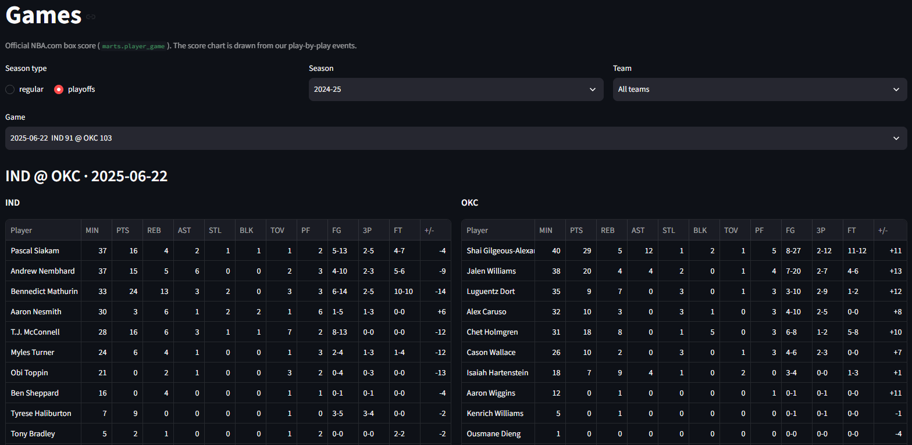
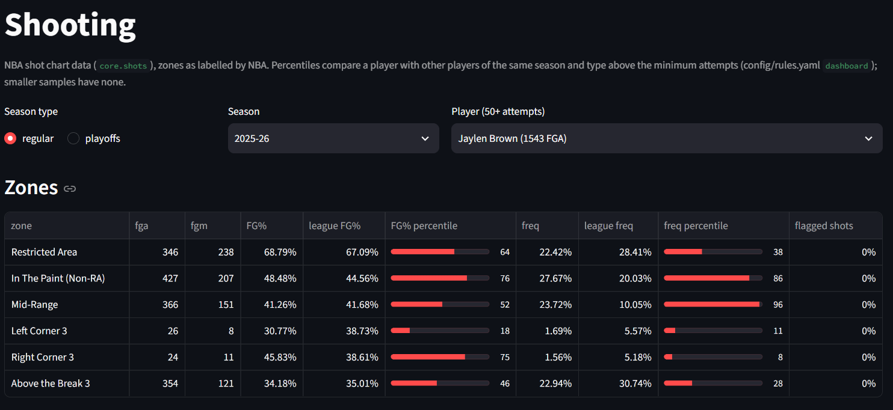
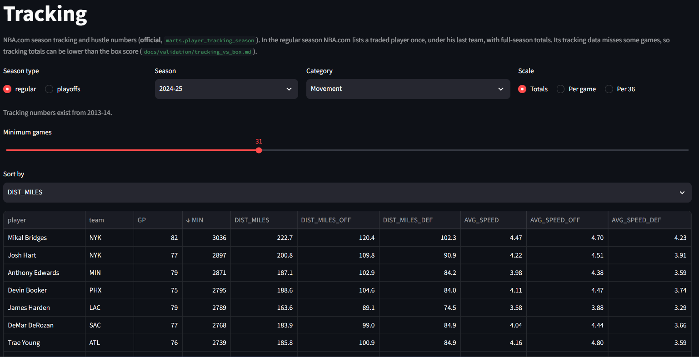
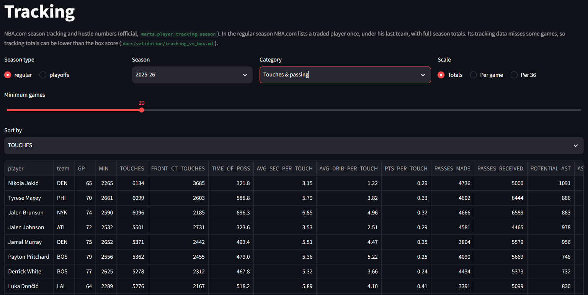

# nba-analytics-platform

A personal NBA data platform built from raw play-by-play: a validated event database for
**1996-97 → 2025-26**, my own **stint and possession logic** checked game by game against an
independent reference, and a **Streamlit dashboard** on top. On/off and RAPM are next.
Portfolio project by Ming Chen (Wake Forest MSBA, sports analytics).

## Why

Public NBA metrics hide many judgment calls: when a possession ends, who gets credit when a
substitution happens between free throws, what counts as garbage time. This project makes
every one of those calls explicit, written down (`config/rules.yaml`, `docs/possession_rules.md`),
tested, and versioned, so each number can be explained and reproduced.

## Highlights

- **60 season files loaded and validated** (regular season + playoffs, 1996-97 → 2025-26):
  37,986 games, 17.5 M events, 6.3 M shots. A rebuild from zero reproduced all 11 loaded tables exactly
  (row counts and content hashes; checked before the stint and possession tables were added).
- **Own stints and possessions for every season**: 1.16 M stints and 7.3 M possessions, each
  row stamped with the `rules_version` and rule profile that built it.
- **Every difference from the reference is investigated, not tuned away.** Possession counts are
  compared with [pbpstats](https://github.com/dblackrun/pbpstats) per team and game; the gaps that
  remain were traced to concrete causes (see below) and documented instead of bending the rules to
  match a number.
- **Rules live in configuration, not code**: two profiles, `pbpstats_compat` (a baseline that copies
  pbpstats) and `custom` (my own choices), with the rule "copy first, then deviate, one documented
  change at a time".
- **Fail loudly**: an unmapped player, team or event type stops the load; data is never silently
  dropped or "fixed" to make a check pass. 262 automated tests.

## Possession results

Share of team-games whose possession count equals pbpstats' (check 8), profile `pbpstats_compat`:

| Seasons | Identical | Within 1 | What explains the gap |
|---|---|---|---|
| 2000-01 → 2015-16 | 97.2 % – 99.3 % | 99.9 % – 100 % | small residuals, mostly in the last seconds of a period |
| 2016-17 → 2024-25 | 70 % – 83 % | 94 % – 99 % | the source clock gains tenths of a second from 2016-17; pbpstats behaves as if it truncates to whole seconds (a possession starting with 2.4 s left counts as "2 s" and is excluded), I compare the exact time. A **deliberate, documented** difference (about 500-560 possessions per season) |
| 1996-97 → 1999-00, 2025-26 | n/a | n/a | no pbpstats reference exists; internal checks only |

Hard check on every season (all 60 pass): each team's possession points plus free throws outside
possessions equal the final score. Per-season table: `docs/validation/possession_summary.md`.
One season (2017-18) is the outlier at 70 %: the source inserts late-added events out of order early
in that season (analysis in `docs/decisions.md`, 2026-10-22).

## Dashboard

Seven read-only Streamlit pages (`app/`): data health, reference data, games (official box score and
score-margin chart), players (leaderboard and game log), teams, shooting (zone frequency and accuracy
with league percentiles, shot chart) and tracking / hustle. Layers 2 and 3 (on/off, lineups, RAPM)
are specified in `docs/dashboard_spec.md`. Every number is labelled by where it comes from (official
NBA.com value, counted from my play-by-play, or model).

| | |
|---|---|
|  |  |
| **Games**: official box score of a 2024-25 playoff game | **Shooting**: share and accuracy by zone, with league percentiles |
|  |  |
| **Tracking**: distance and speed (2024-25), totals / per game / per 36 | **Tracking**: touches and passing (2025-26) |

## Architecture

```
raw files (never modified; SHA-256 manifest)
   │  Python adapters: parse IDs, clock → seconds, map event types, apply corrections
   ▼
staging (Parquet, one schema per source)
   │  load per season in one transaction; hard checks before commit
   ▼
DuckDB  core:       games · events · shots · teams · players · stints · possessions · segments
        staging:    event_lineups (10 players on court per event)
        reference:  pbpstats possessions, NBA.com official possessions / tracking / hustle /
                    play types, matchups (comparison only, never feeds core)
        marts:      player / team box scores, shot zones, tracking (what the app reads)
        validation: one row per check per season
   │  next: on/off → lineups → RAPM
   ▼
Streamlit (read-only)
```

Code: `src/nba_platform/` — `ingest/` (downloads), `staging/` (one adapter per source), `core/`
(stints, free throws, rebounds, possessions: pure functions), `validate/` (checks and reports),
`marts/`, `reference/`, `pipeline.py` and `rebuild.py`. Keys and joins: `docs/data_model.md`;
columns: `docs/data_dictionary.md`.

## Design principles

1. **Observed facts, source values and model assumptions are never mixed** in one column; every
   possession and metric records the rules version that produced it.
2. **Raw data is never modified.** Fixes go in a corrections table, applied in staging.
3. **Unknown means NULL.** No invented IDs, times or values.
4. **Basketball definitions are separate from code**, written down with examples, and tested on
   real event sequences (`tests/fixtures/possessions/`).
5. **Never bend the logic to match a reference number.** A mismatch is investigated and reported.
6. Questions that are still open stay open on purpose: for example how to credit a possession when
   a substitution happens between free throws (three options, all computable from the data).

The full decision log, with the reasons, is `docs/decisions.md`.

## Data sources and terms

| Source | Used for | Notes |
|---|---|---|
| [ramirobentes/nba_data](https://github.com/ramirobentes/nba_data) | play-by-play + on-court lineups, 1996-97 → 2025-26 | no license stated → files kept local only |
| [shufinskiy/nba_data](https://github.com/shufinskiy/nba_data) | NBA shot-chart locations (all seasons); pbpstats possessions, official PBP and matchups (reference) | single files downloaded, not redistributed |
| nba_api (stats.nba.com) | box scores, game lists, official possessions, tracking / hustle / play-type data | cached locally, throttled requests; NBA terms apply |
| BigDataBall (purchased) | cross-source validation only (7 seasons, 2004-05 → 2014-15) | never redistributed |

**No raw or third-party data is in this repository.** Only code, documentation and my own derived
summaries (IDs and numbers) are committed. Basketball Reference is not scraped.

**License.** The code and documentation are released under the [MIT License](LICENSE). The license
covers only my own work; it grants no rights to any third-party data (ramirobentes, shufinskiy,
NBA.com, BigDataBall, ...), which stays under its owners' terms and must be obtained from them.
`tests/fixtures/possessions/` holds short windows of real 2004-05 sequences (IDs, clocks and scores
only, no text) used to test the possession rules. `data/raw/manifest.csv` lists the publicly
downloadable files (URL, time, SHA-256); the listing of purchased files stays on my machine.

## Validation

Every season runs two levels of checks; every anomaly is reported (`docs/validation/season_report.md`),
and data is never changed to make a check pass.

- **Hard checks** (the season is not loaded if one fails): every ID resolves, unique event keys, no
  player twice in a lineup, game time in range, no row inflation in joins.
- **Warnings** (reported, season loaded): game counts vs the schedule, event points = final score,
  5 + 5 players on court, substitution consistency, player-seconds = 5 × game length, minutes vs box
  score, shot-location join, cross-source lineups, possession counts vs pbpstats.

Cross-checks that came out of it:

- Play-by-play minutes match box scores within rounding for more than 99.8 % of player-games in most
  seasons; the large gaps were traced to incomplete box scores.
- Player box-score statistics counted from my events equal the official ones in at least 99.7 % of
  player-games for every statistic in every season (`docs/validation/box_vs_pbp.md`); the comparison
  also exposed two era-specific encodings (who is credited with a steal; a new technical-foul code in 2023-24).
- Shot locations join to at least 99.88 % of field-goal attempts in every season.
- Against BigDataBall (7 seasons): final scores agree in all but 2 of 8,883 games, and where the
  lineups disagree, box-score minutes and official substitutions side with the primary source in
  641 of 647 decidable cases.

## How this was built

The basketball rules, the validation standards and every design trade-off are mine, recorded in
`docs/decisions.md`. The code was written with Claude (Anthropic) as a pair programmer under written
working agreements (`CLAUDE.md`): Claude proposes and implements, I decide each rule and review each
step, and nothing is tuned to match a reference number. The commit trailers say so.

## Run it

You need the data first (it is not in the repository). On Windows (on Linux/macOS use `.venv/bin/python`):

```bash
py -3.13 -m venv .venv
.venv/Scripts/python -m pip install -r requirements.txt
.venv/Scripts/python -m pip install -e .

# tests: the unit tests run without any data; integration tests are skipped without a database
.venv/Scripts/python -m pytest -q

# download one season (raw files + manifest with url, time, sha256), then load and validate it
.venv/Scripts/python -m nba_platform.ingest.download --season-end-year 2005
.venv/Scripts/python -m nba_platform.pipeline --season-end-year 2005   # also builds stints and possessions

# everything derived from the loaded play-by-play, in one run (core tables, marts, reports)
.venv/Scripts/python -m nba_platform.rebuild

# dashboard (read-only)
.venv/Scripts/streamlit run app/data_health.py
```

Other entry points are listed in the module docstrings (`nba_platform.pipeline --all`,
`nba_platform.build_core`, `nba_platform.marts.*`, `nba_platform.validate.*`).

**Database location.** The DuckDB file lives outside the project at
`%LOCALAPPDATA%\nba_platform\nba_platform.duckdb` (Linux/macOS: `~/.local/share/nba_platform/`);
`NBA_PLATFORM_DB` overrides it. Only the pipeline writes to it; open it read-only in DBeaver or
Streamlit. If the project folder is synced (Synology Drive, OneDrive, Dropbox), exclude `data/`,
`.venv/` and `*.duckdb`: a sync client corrupted a synced database once.

**Pre-commit hook.** The repository ships a hook that runs the whole test suite and blocks a commit
if anything fails. Install it once per clone: `git config core.hooksPath scripts/git-hooks`.

## Roadmap

- [x] Raw → staging → DuckDB for every season, with two-level validation and a pytest pre-commit hook
- [x] Shots with quality flags; box-score, pbpstats and BigDataBall cross-checks; reproducibility check
- [x] NBA.com reference data (official possessions, tracking, hustle, shot context, play types, matchups)
- [x] Stints and possessions for all 60 season files (`pbpstats_compat` profile)
- [x] Dashboard layer 1: games, players, teams, shooting, tracking
- [ ] `custom` profile: first documented deviations; compare the three ways to credit a possession
      when a substitution happens between free throws
- [ ] On/off and lineups, then RAPM (ridge, penalty chosen by game-grouped cross-validation)
- [ ] Playoff Matchup Adjustment Tracker and video tracking, linked by shared IDs

More: `docs/README.md` is the map of the documentation.
