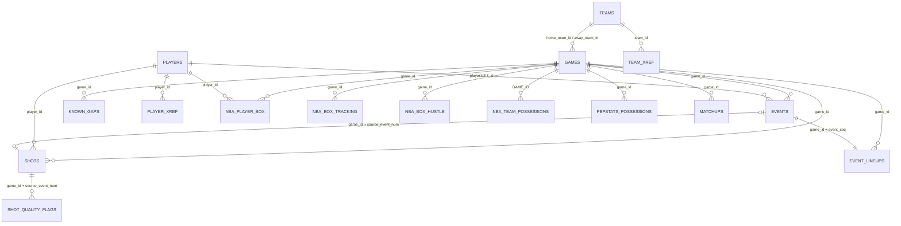

# Data model: keys and relationships

Row counts as of 2026-10-20 (DuckDB, `%LOCALAPPDATA%\nba_platform\nba_platform.duckdb`).
Column-level detail is in `data_dictionary.md`; this page is about **keys and how tables join**.

## Why DBeaver shows few primary keys and no foreign keys

DuckDB does enforce PRIMARY KEY / FOREIGN KEY, but this project deliberately declares them
only on small lookup tables:

- **The pipeline reloads one season at a time (delete, then insert).** A DuckDB foreign key
  has no `ON DELETE CASCADE`: a parent row cannot be deleted while a child row points to it,
  so every reload would need the tables dropped in a special order.
- **Cost.** `core.events` (17.5 M rows) and `core.shots` (6.3 M rows) would need an index per
  key; that slows loads and uses a lot of memory for no analytical benefit.
- **The guarantee lives in the pipeline instead.** The same rules are validation checks that
  run on every season load; a violation of a *hard* check stops the load (CLAUDE.md,
  "Fail loudly"). This is the same idea as dbt's `unique` and `relationships` tests.

So the model below has **logical** keys. "Enforced" means the database itself rejects a
violation; "Check" means a validation check does (numbers refer to `validation.results`).

New small mart tables (`marts.*`) get real PRIMARY KEYs.

## Entity-relationship diagram (logical)

`reference.nba_player_box` is built by `nba_platform.reference.player_box`; `marts.player_game_pbp`
(unique on `(game_id, player_id)`) by `nba_platform.marts.player_game_pbp`.

## Core tables

| Table | Rows | Key (logical) | Enforced / check | Joins to |
|---|---|---|---|---|
| `core.games` | 37,986 | `game_id` | **PRIMARY KEY** | `home_team_id`, `away_team_id` → `core.teams` (check 9) |
| `core.teams` | 30 | `team_id` | **PRIMARY KEY** | rebuilt from `team_xref` on every load |
| `core.players` | 2,898 | `player_id` | **PRIMARY KEY** | rebuilt from `staging.player_names` |
| `core.team_xref` | 892 | `(source, season_end_year, source_team_key)` | **PRIMARY KEY** | → `core.teams` |
| `core.player_xref` | 4,048 | `(source, source_player_key)` | **PRIMARY KEY** | → `core.players` (check 9) |
| `core.events` | 17,476,387 | `(game_id, event_seq)` and `(game_id, source_event_num)` | check 102 (hard) | `game_id` → games; `team_id` → teams; `player1/2/3_id` → players (check 9) |
| `core.shots` | 6,328,071 | `(game_id, source_event_num)` | check 107 (hard) | the shot event in `core.events`; `player_id`, `team_id` (check 9) |
| `core.shot_quality_flags` | 1,436,811 | `(game_id, source_event_num, flag)` | **PRIMARY KEY** | → `core.shots` |
| `core.known_gaps` | 2 | `(game_id, issue)` | **PRIMARY KEY** | → `core.games` |
| `core.stints` | 1,161,854 | `(game_id, stint_id)` | **PRIMARY KEY** | `game_id` → games; `events.stint_id` → stints |
| `core.possessions` | 7,275,190 | `(game_id, possession_id)` | **PRIMARY KEY**; checks 112, 7, 8 | `events.possession_id` → possessions; teams → `core.teams` |
| `core.possession_stint_segments` | 8,128,672 | `(game_id, possession_id, segment_seq)` | **PRIMARY KEY** | → possessions, → stints |

`core.events` also has `stint_id`, `possession_id`, `chance_id`, `foul_event_seq`, `is_technical_ft`,
`is_between_possessions_ft`, filled by `nba_platform.build_core` (every season).
`foul_event_seq` points to another `event_seq` of the same game.

## Marts (layer 1, real primary keys)

| Table | Key | Built from |
|---|---|---|
| `marts.player_game_pbp` (validation only) | `(game_id, player_id)` (not enforced) | `core.events`, `staging.event_lineups` |
| `marts.player_game` | `(game_id, player_id)` **PRIMARY KEY** | `reference.nba_player_box`, `core.games`, `marts.player_game_pbp` |
| `marts.player_season` | `(season_end_year, season_type, player_id, team_id)` **PRIMARY KEY** | `marts.player_game` |
| `marts.team_game` | `(game_id, team_id)` **PRIMARY KEY** | `marts.player_game`, `reference.nba_team_possessions` |
| `marts.team_season` | `(season_end_year, season_type, team_id)` **PRIMARY KEY** | `marts.team_game` |
| `marts.shot_zones_league` | `(season_end_year, season_type, zone)` **PRIMARY KEY** | `core.shots`, `core.games` |
| `marts.shot_zones_team` | `(season_end_year, season_type, team_id, side, zone)` **PRIMARY KEY** | `core.shots`, `core.games`, `marts.shot_zones_league` |
| `marts.shot_zones_player` | `(season_end_year, season_type, player_id, zone)` **PRIMARY KEY** | `core.shots`, `core.shot_quality_flags` |
| `marts.player_tracking_season` | `(season_end_year, season_type, player_id, team_id)` **PRIMARY KEY** | `reference.nba_tracking`, `reference.nba_hustle` |
| `marts.player_onoff_season` | `(season_end_year, season_type, team_id, player_id)` **PRIMARY KEY** | `core.stints`, `core.possessions`, `core.possession_stint_segments`, `core.events`, `core.games` |
| `marts.lineup_stats` | `(season_end_year, season_type, team_id, lineup_key)` **PRIMARY KEY** | same as above |
| `marts.pair_stats` | `(season_end_year, season_type, team_id, player_a, player_b)` **PRIMARY KEY** | same as above |
| `marts.team_efficiency_season` | `(season_end_year, season_type, team_id)` **PRIMARY KEY** | `core.possessions`, `core.events`, `core.games` |
| `marts.player_game_tracking` | `(game_id, player_id)` **PRIMARY KEY** | `reference.nba_box_tracking`, `reference.nba_box_hustle`, `core.games`, `core.players` |
| `marts.player_rapm` (prototype) | `(window_id, player_id)` **PRIMARY KEY** | `core.possessions`, `core.possession_stint_segments`, `core.stints`, `core.games` |
| `marts.matchup_pairs` | `(game_id, defender_id, offender_id)` **PRIMARY KEY** | `reference.matchups`, `core.games`, `core.players`, `core.teams` |

## Staging and validation

| Table | Rows | Key (logical) | Check |
|---|---|---|---|
| `staging.event_lineups` | 17,476,387 | `(game_id, event_seq)`, one row per event | check 3 (5 + 5 distinct players), 104 (no player twice), 106 (row counts equal) |
| `staging.player_names` | 22,536 | `(source, season_end_year, season_type, player_id, name)` | feeds `core.players` |
| `validation.results` | 1,093 | `(run_at, season_end_year, season_type, check_id)` | the results of the checks above |

## Reference tables (comparison and inputs, not our logic)

| Table | Rows | Grain / key (logical) | Joins |
|---|---|---|---|
| `reference.nba_player_box` | 786,768 | `(game_id, player_id)` | check on load: unique key, `game_id` in `core.games` |
| `reference.nba_box_tracking` | 93,804 | `(game_id, person_id)` | `game_id` → games (100% in `core.games`) |
| `reference.nba_box_hustle` | 68,022 | `(game_id, person_id)` | same |
| `reference.nba_team_possessions` | 80,148 | `(GAME_ID, TEAM_ID)` | `GAME_ID` → games |
| `reference.nba_tracking` | 116,866 | `(season, season_type, request_param_1, PLAYER_ID, TEAM_ID)` | `season` is the text label `'2024-25'`, not `season_end_year` |
| `reference.nba_hustle` | 8,432 | `(season, season_type, request_param_1, PLAYER_ID)` | same |
| `reference.nba_shot_context`, `reference.nba_play_type` | 157,192 / 109,118 | season-level, per player or team | same |
| `reference.pbpstats_possessions` | 6,082,716 | `(game_id, possession_seq)` | `game_id` → games |
| `reference.possession_count_benchmark` (+ `_official`) | 64,176 / 75,970 | `(game_id, team_abbr)` | `game_id` → games |
| `reference.matchups` | 1,886,689 | `(game_id, person_id, ...)` (matchup rows) | `game_id` → games (100% in `core.games`) |

Not all reference tables use the same names for the same thing (`GAME_ID` vs `game_id`,
`PLAYER_ID` vs `person_id`, season label vs end year). That is how the sources deliver them
and they are kept as delivered; the marts tables use the project conventions
(CLAUDE.md "Conventions").

## Using it in DBeaver

The relationships above exist only in this document and in the checks. To see them in
DBeaver without changing the database:

1. Open the table, **right-click the column, Logical, Create virtual foreign key** (or in
   the ER diagram: **View Diagram**, then the dotted-line tool).
2. Pick the target table and its key (for example `core.events.game_id` → `core.games.game_id`).

Virtual keys are stored in DBeaver's project settings, not in the DuckDB file, so they do not
affect the pipeline. Open the database **read-only** (CLAUDE.md "Tech stack").

## Conventions that make the joins work

- `game_id`: TEXT, 10 characters with leading zeros.
- `player_id`, `team_id`: INTEGER, NBA official IDs; team-level events have `player_id` NULL.
- A season is `season_end_year` (2005 = 2004-05) plus `season_type` (`regular` | `playoffs`).
- A join must never inflate rows: check 106 compares loaded and staged row counts.
